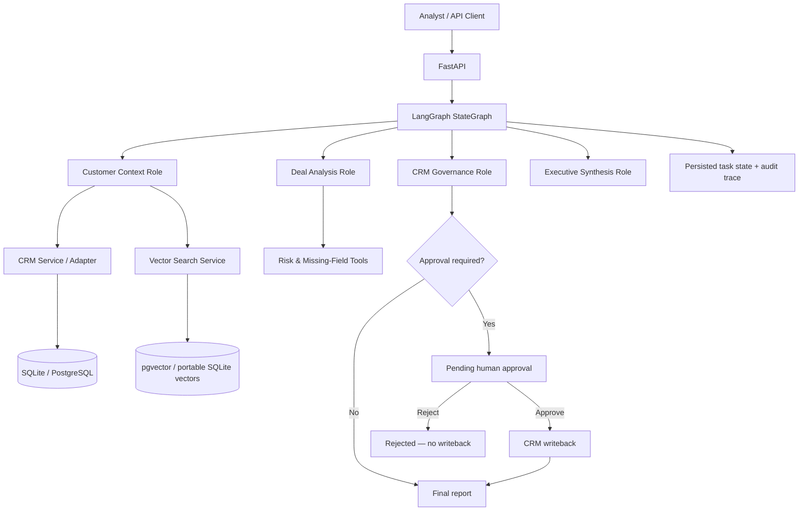

# DealFlow AI Agent

<p align="center">
  <strong>A governed, LangGraph-powered CRM workflow agent for sales opportunity review.</strong>
</p>

<p align="center">
  
  
  
  
  
  
  
</p>

DealFlow AI Agent reviews sales opportunities by combining structured CRM records with unstructured customer-support history. It retrieves relevant context, evaluates deal risk, identifies missing information, recommends next steps, and drafts CRM updates. When a proposed change is high-risk or affects an important field, the workflow pauses for **human approval before writeback**.

This is an engineering-focused portfolio project demonstrating stateful agent orchestration, retrieval, workflow governance, persistence, and observability. It runs locally and in CI; it is **not deployed as a production service**.

## Contents

- [Highlights](#highlights)
- [Architecture](#architecture)
- [Workflow and approval model](#workflow-and-approval-model)
- [Technology stack](#technology-stack)
- [Data and provenance](#data-and-provenance)
- [Quick start](#quick-start)
- [Docker setup](#docker-setup)
- [Optional providers and CRM integration](#optional-providers-and-crm-integration)
- [API overview](#api-overview)
- [Tests and evaluation](#tests-and-evaluation)
- [Repository structure](#repository-structure)
- [Limitations and future work](#limitations-and-future-work)
- [Documentation](#documentation)

## Highlights

- **Stateful workflow orchestration:** a 10-node LangGraph `StateGraph` with typed state and conditional routing.
- **Role-based agent design:** Customer Context, Deal Analysis, CRM Governance, and Executive Synthesis roles supervised by LangGraph.
- **Context retrieval:** combines relational CRM data with vector search over customer-support tickets and notes.
- **Human-in-the-loop governance:** high-risk reviews and important-field changes pause for approval; rejection never writes to the CRM.
- **Durable task state:** task snapshots and audit events are persisted, allowing pending reviews to resume after an API restart.
- **Async review mode:** starts long-running work and returns a task ID for status and trace polling.
- **Auditable execution:** node-level audit logs, timing instrumentation, and a task trace endpoint.
- **Pluggable integrations:** local and mock CRM adapters, plus an optional HubSpot CRM v3 adapter with dry-run enabled by default.
- **Portable development:** SQLite and a deterministic local embedder support offline development; Docker Compose runs PostgreSQL with pgvector.
- **Engineering quality:** automated tests, GitHub Actions CI, linting, and a deterministic evaluation harness.

## Architecture



### Workflow and approval model

The workflow moves through these stages:

1. Parse the review request.
2. Retrieve the opportunity and account context from the CRM store.
3. Retrieve related support history using vector search.
4. Analyze risk signals.
5. Detect missing CRM fields.
6. Recommend next steps.
7. Draft a proposed CRM update.
8. Evaluate the approval policy.
9. Pause for approval when required, or continue to writeback when permitted.
10. Finalize the report and persist the outcome.

**Approval policy:** a risk score at or above `HIGH_RISK_THRESHOLD`, or a proposed change to a configured important field (`stage`, `deal_value`, or `close_date`), routes the task to human approval. Approval resumes the workflow; rejection records the decision and performs no writeback.

The LLM is optional and confined to final narrative synthesis. It does not control routing, approval decisions, or CRM writes.

## Technology stack

| Area | Technologies |
|---|---|
| Language | Python 3.11 |
| API | FastAPI, Pydantic, Uvicorn |
| Agent orchestration | LangGraph, LangChain |
| Relational storage | SQLAlchemy, SQLite, PostgreSQL |
| Vector retrieval | pgvector, cosine similarity |
| Embeddings | Local deterministic hashing provider; optional OpenAI embeddings |
| LLM synthesis | Deterministic local summary; optional OpenAI model |
| CRM integration | Local adapter, mock external adapter, optional HubSpot CRM v3 |
| Infrastructure | Docker, Docker Compose |
| Quality | pytest, Ruff, GitHub Actions |

## Data and provenance

The repository includes scripts for an optional data-ingestion pipeline using two public Kaggle datasets:

- `nilkamalsaha/crm-sales-opportunities-on-google-sheets`
- `suraj520/customer-support-ticket-dataset`

The documented verification run reported:

| Dataset / table | Rows |
|---|---:|
| CRM accounts | 85 |
| CRM opportunities | 8,800 |
| Support tickets | 8,469 |
| Client notes derived from tickets | 8,469 |
| Risk notes | 4,729 |
| Embedded vector documents | 24,521 |

**Important data caveat:** the source datasets do not share a native account identifier. A deterministic, seeded mapping links support tickets to CRM accounts and opportunities for the workflow simulation. The source CRM and support rows remain the public dataset records; the linking layer and additional workflow scaffolding are synthetic and flagged accordingly.

You do not need Kaggle credentials to try the project: the offline demo seed provides a local dataset.

## Quick start

### Prerequisites

- Python 3.11
- Git
- (Optional) Docker Desktop for the PostgreSQL + pgvector setup

### 1. Clone the repository

```bash
git clone https://github.com/<YOUR_GITHUB_USERNAME>/DealFlow-AI-Agent.git
cd DealFlow-AI-Agent
```

Replace the repository URL with your GitHub repository URL after creating it.

### 2. Create and activate a virtual environment

**Windows PowerShell**
```powershell
py -3.11 -m venv .venv
.venv\Scripts\Activate.ps1
```

**macOS / Linux**
```bash
python3.11 -m venv .venv
source .venv/bin/activate
```

### 3. Install dependencies and configure environment

```bash
python -m pip install --upgrade pip
pip install -r requirements.txt
```

Copy `.env.example` to `.env` and keep the default local settings for a key-free run.

**Windows PowerShell**
```powershell
Copy-Item .env.example .env
```

**macOS / Linux**
```bash
cp .env.example .env
```

Do not commit `.env` or real API credentials.

### 4. Seed the demo database

```bash
python -m scripts.seed_demo_data
```

### 5. Start the API

```bash
uvicorn app.main:app --reload --port 8000
```

Open:

- API base: `http://localhost:8000`
- Interactive Swagger docs: `http://localhost:8000/docs`
- Health check: `http://localhost:8000/health`

You can also use the Makefile shortcuts:

```bash
make install
make seed-demo
make dev
```

## Docker setup

Docker Compose starts the FastAPI service and a PostgreSQL instance with pgvector:

```bash
docker compose up --build -d
docker compose exec api python -m scripts.seed_demo_data
```

Stop the services:

```bash
docker compose down
```

The Compose configuration uses a local development database credential. Change it before using this setup beyond a local demo.

## Optional providers and CRM integration

All optional external integrations are disabled by default.

### Embeddings and LLM synthesis

The default local providers require no API key and make runs reproducible. To opt into OpenAI providers, configure the relevant variables in `.env`:

```dotenv
EMBEDDING_PROVIDER=openai
OPENAI_API_KEY=your-key
OPENAI_EMBEDDING_MODEL=text-embedding-3-small

LLM_PROVIDER=openai
LLM_MODEL=gpt-4o-mini
```

Use only your own credentials. Never commit secrets.

### HubSpot CRM adapter

The optional HubSpot adapter is selected with:

```dotenv
CRM_ADAPTER=hubspot
HUBSPOT_ACCESS_TOKEN=your-private-app-token
HUBSPOT_DRY_RUN=true
```

Dry-run is enabled by default. In dry-run mode, the adapter validates and maps a proposed update without sending a PATCH request. Real external writes require deliberately setting `HUBSPOT_DRY_RUN=false`; the workflow's human-approval gate and strict field allowlist still apply. See [CRM integration details](docs/integrations.md).

## API overview

Base URL: `http://localhost:8000`

| Method | Endpoint | Purpose |
|---|---|---|
| `GET` | `/health` | Health check |
| `POST` | `/search/vector` | Search relevant vector documents |
| `GET` | `/opportunities/{id}/context` | Retrieve opportunity context |
| `POST` | `/agent/review-opportunity` | Run a synchronous opportunity review |
| `POST` | `/agent/review-opportunity-async` | Start an asynchronous review |
| `GET` | `/agent/tasks/{id}` | Retrieve task status and result |
| `GET` | `/agent/tasks/{id}/trace` | Retrieve ordered execution trace |
| `POST` | `/agent/tasks/{id}/approve` | Approve and resume a pending task |
| `POST` | `/agent/tasks/{id}/reject` | Reject a pending task |

Example review request:

```bash
curl -X POST "http://localhost:8000/agent/review-opportunity" \
  -H "Content-Type: application/json" \
  -d '{
    "opportunity_id": "OPP-DEMO1",
    "task": "Review this opportunity, identify blockers, summarize client history, and recommend next steps."
  }'
```

## Tests and evaluation

Run the offline test suite:

```bash
pytest
```

Run lint checks:

```bash
ruff check app scripts tests
```

Run the deterministic evaluation harness against the currently loaded data:

```bash
python -m scripts.evaluate_agent
```

Or use:

```bash
make test
make lint
make evaluate
```

The evaluation checks retrieval scoping, risk-score separation, approval routing, and data-pipeline integrity. These are deterministic sanity/regression checks, not a benchmark against labeled business outcomes. See [Evaluation](docs/evaluation.md).

## Repository structure

```text
.
├── app/
│   ├── agents/          # LangGraph workflow, state, nodes, roles, routers
│   ├── api/             # FastAPI routes and dependencies
│   ├── db/              # Database models, sessions, vector column
│   ├── integrations/    # CRM adapter implementations
│   ├── schemas/         # Request and response schemas
│   ├── services/        # CRM, embeddings, retrieval, approval, evaluation
│   ├── tools/           # CRM, vector, risk, approval, audit tools
│   └── utils/           # Configuration and logging
├── data/                # Data directories / placeholders
├── docs/                # Design, evaluation, integration and demo guides
├── scripts/             # Ingestion, transformation, seeding and evaluation
├── tests/               # Unit and integration tests
├── .github/workflows/   # Continuous integration
├── Dockerfile
├── docker-compose.yml
├── Makefile
├── pyproject.toml
├── requirements.txt
└── .env.example
```

## Limitations and future work

- The project is a portfolio prototype and is not production-deployed.
- Risk scoring and CRM update drafting use deterministic, explainable rules by default; they are not trained predictive models.
- The default hashing embedder is intended for reproducible local demonstrations, not high-quality semantic retrieval at production scale.
- The async runner is in-process; production execution would require a durable worker queue.
- Production deployment would also require authentication/authorization, tenant isolation, rate limiting, managed secrets, stronger operational monitoring, and scalable vector indexes.

Further implementation notes are in [Productionization](docs/productionization.md).

## Documentation

- [Technical walkthrough](docs/technical_walkthrough.md)
- [Project summary](docs/project_summary.md)
- [Multi-agent design](docs/multi_agent_design.md)
- [Evaluation approach](docs/evaluation.md)
- [CRM integrations and safety controls](docs/integrations.md)
- [Productionization notes](docs/productionization.md)
- [Project review](docs/project_review.md)
- [Demo commands and sample responses](docs/demo/)

## License

This project is licensed under the [MIT License](LICENSE).
